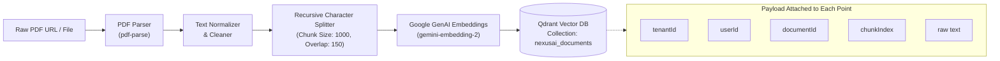
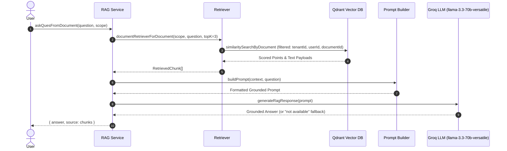
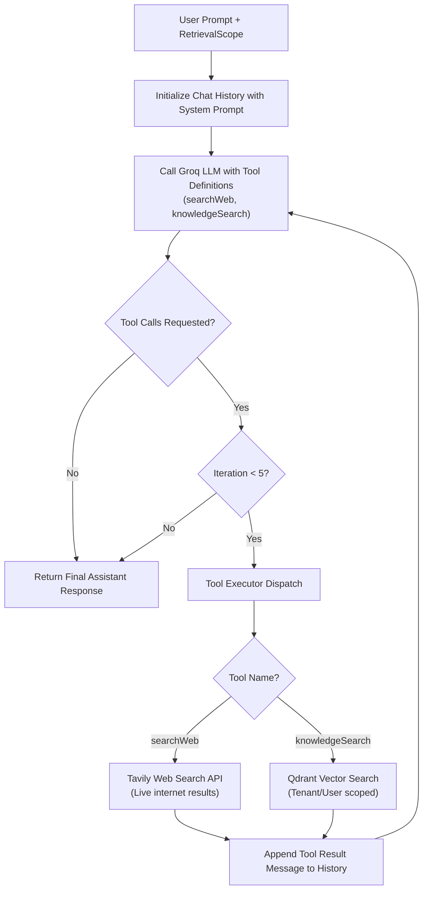

# Axon AI Engine (`packages/ai`) 🧠⚡

> **Note**: A full, detailed documentation file has also been generated in [README.md](file:///c:/Users/NISHANT%20SINGH/OneDrive/Desktop/Axon/packages/ai/README.md).

The **Axon AI Engine** is a modular, multi-tenant AI, RAG (Retrieval-Augmented Generation), and autonomous agent package. It powers semantic document ingestion, vector search, grounded question-answering, and tool-augmented reasoning across external web sources and internal company knowledge bases.

---

## 📑 Table of Contents

- [Overview](#-overview)
- [Architecture & Processing Pipelines](#-architecture--processing-pipelines)
  - [1. Document Ingestion & Vector Indexing](#1-document-ingestion--vector-indexing)
  - [2. Multi-Tenant Scoped RAG Pipeline](#2-multi-tenant-scoped-rag-pipeline)
  - [3. Autonomous Tool-Calling Agent Loop](#3-autonomous-tool-calling-agent-loop)
- [Module Breakdown & File Structure](#-module-breakdown--file-structure)
  - [Document Processing (`src/document`)](#document-processing-srcdocument)
  - [Embeddings Service (`src/embeddings`)](#embeddings-service-srcembeddings)
  - [Vector Database (`src/vector`)](#vector-database-srcvector)
  - [Types & Multi-Tenancy Scope (`src/types`)](#types--multi-tenancy-scope-srctypes)
  - [RAG Core (`src/rag`)](#rag-core-srcrag)
  - [LLM Engine (`src/llm`)](#llm-engine-srcllm)
  - [Tools System (`src/tools`)](#tools-system-srctools)
  - [Agent Orchestrator (`src/agent`)](#agent-orchestrator-srcagent)
- [Tools & External Integrations](#-tools--external-integrations)
- [Multi-Tenancy & Access Control](#-multi-tenancy--access-control)
- [Environment Configuration](#-environment-configuration)
- [Exported APIs & Usage Examples](#-exported-apis--usage-examples)
- [Summary of Built Capabilities](#-summary-of-built-capabilities)

---

## 🔭 Overview

`packages/ai` operates as an independent domain package that can be consumed by backend services (such as `apps/api`) or standalone background workers.

### Key Capabilities Built:
1. **Document Ingestion**: Extracts text from PDFs and splits into overlapping semantic chunks.
2. **Dense Vector Embeddings**: Generates high-dimensional vector embeddings using Google Generative AI.
3. **Multi-Tenant Vector Storage**: Stores and indexes chunk embeddings in Qdrant with tenant and user isolation.
4. **Strict Context RAG**: Answers queries grounded strictly in document contents with hallucination guardrails.
5. **ReAct Autonomous Agent**: Groq-powered multi-turn agent capable of calling function tools (Internal Knowledge Search and Tavily Web Search) with automatic fallback and source attribution.

---

## 🏛️ Architecture & Processing Pipelines

### 1. Document Ingestion & Vector Indexing



---

### 2. Multi-Tenant Scoped RAG Pipeline



---

### 3. Autonomous Tool-Calling Agent Loop



---

## 📁 Module Breakdown & File Structure

```text
packages/ai/
├── src/
│   ├── agent/
│   │   └── agent.service.ts         # High-level entry point for agent queries
│   ├── document/
│   │   ├── chunking.ts              # Recursive text splitting & normalization
│   │   └── pdf.parser.ts            # PDF parsing & text extraction
│   ├── embeddings/
│   │   └── embedding.service.ts     # Google Generative AI embeddings generator
│   ├── llm/
│   │   ├── client.ts                # Multi-turn autonomous tool loop client
│   │   └── rag.client.ts            # Low-temperature strictly grounded RAG client
│   ├── rag/
│   │   ├── promptBuilder.ts         # Prompt templates with anti-hallucination rules
│   │   ├── rag.service.ts           # Single-document & all-documents RAG queries
│   │   └── retriever.ts             # Multi-tenant vector similarity retriever
│   ├── tools/
│   │   ├── knowledge.tool.ts        # Internal document retrieval tool wrapper
│   │   ├── tavily.tool.ts           # External real-time search tool via Tavily API
│   │   ├── tool.definitions.ts      # LLM function schemas for tool calling
│   │   └── tool.executor.ts         # Tool execution dispatcher
│   ├── types/
│   │   └── retrieval.ts             # Scope and Chunk TypeScript interfaces
│   └── vector/
│       ├── qdrant.client.ts         # Qdrant client connection
│       ├── qdrant.collection.ts     # Collection creation & configuration
│       └── qdrant.service.ts        # Upsert and filtered similarity query routines
├── package.json
└── tsconfig.json
```

---

### Document Processing (`src/document`)

- **[`pdf.parser.ts`](file:///c:/Users/NISHANT%20SINGH/OneDrive/Desktop/Axon/packages/ai/src/document/pdf.parser.ts)**:
  - Function: `extractPdfText(pdfUrl: string)`
  - Uses `pdf-parse` (`PDFParse` class) to fetch and extract raw text from remote document URLs.
  - Ensures clean teardown with `await parser.destroy()`.
- **[`chunking.ts`](file:///c:/Users/NISHANT%20SINGH/OneDrive/Desktop/Axon/packages/ai/src/document/chunking.ts)**:
  - Function: `splitDocument(text: string)`
  - Normalizes carriage returns (`\r\n` $\rightarrow$ `\n`) and collapses excessive newlines.
  - Leverages `@langchain/textsplitters` `RecursiveCharacterTextSplitter`.
  - **Chunk Size**: `1000` characters.
  - **Overlap**: `150` characters.
  - **Separators**: `["\n\n", "\n", ".", " "]`.

---

### Embeddings Service (`src/embeddings`)

- **[`embedding.service.ts`](file:///c:/Users/NISHANT%20SINGH/OneDrive/Desktop/Axon/packages/ai/src/embeddings/embedding.service.ts)**:
  - Function: `getEmbeddings(text: string[])`
  - Uses `@langchain/google-genai` (`GoogleGenerativeAIEmbeddings`).
  - Model: Defined via `EMBEDDING_MODEL` (e.g. `gemini-embedding-2`).
  - Dimensionality: Defined via `EMBEDDING_DIMENSION` (e.g. `1536`).
  - Batch processes an array of text chunks into dense vector arrays.

---

### Vector Database (`src/vector`)

- **[`qdrant.client.ts`](file:///c:/Users/NISHANT%20SINGH/OneDrive/Desktop/Axon/packages/ai/src/vector/qdrant.client.ts)**:
  - Instantiates `@qdrant/js-client-rest` client pointing to `QDRANT_URL` (default `http://localhost:6333`).
- **[`qdrant.collection.ts`](file:///c:/Users/NISHANT%20SINGH/OneDrive/Desktop/Axon/packages/ai/src/vector/qdrant.collection.ts)**:
  - Function: `createCollection()`
  - Sets up the configured collection (`QDRANT_COLLECTION`) with Cosine distance metric.
- **[`qdrant.service.ts`](file:///c:/Users/NISHANT%20SINGH/OneDrive/Desktop/Axon/packages/ai/src/vector/qdrant.service.ts)**:
  - `upsertDocument(chunks, scope)`: Generates embeddings, attaches UUIDs and multi-tenant payload (`tenantId`, `userId`, `documentId`, `chunkIndex`, `text`), and upserts with `wait: true`.
  - `similaritySearchByUser(query, scope, topK = 5)`: Vector search filtered by `tenantId` and `userId`.
  - `similaritySearchByDocument(query, scope, topK = 3)`: Vector search filtered by `tenantId`, `userId`, and `documentId`.

---

### Types & Multi-Tenancy Scope (`src/types`)

- **[`retrieval.ts`](file:///c:/Users/NISHANT%20SINGH/OneDrive/Desktop/Axon/packages/ai/src/types/retrieval.ts)**:
  - `RetrievalScope`: Encapsulates tenant and user security context:
    ```typescript
    export interface RetrievalScope {
        tenantId: string;
        userId: string;
        documentId?: string;
    }
    ```
  - `RetrievedChunk`: Represents chunks returned from vector searches with relevance score, document ID, and content text.

---

### RAG Core (`src/rag`)

- **[`retriever.ts`](file:///c:/Users/NISHANT%20SINGH/OneDrive/Desktop/Axon/packages/ai/src/rag/retriever.ts)**:
  - `documentRetrieverForDocument(scope, query, topK)`: Performs single-document scoped retrieval.
  - `documentRetrieverForUser(query, scope, topK)`: Performs cross-document scoped retrieval across all documents owned by the user.
- **[`promptBuilder.ts`](file:///c:/Users/NISHANT%20SINGH/OneDrive/Desktop/Axon/packages/ai/src/rag/promptBuilder.ts)**:
  - Formats context and user question.
  - Enforces strict rules:
    - Never invent or assume facts outside context.
    - If unavailable, respond: *"This information is not available in the document."*
    - Bullet points for multi-detail answers.
- **[`rag.service.ts`](file:///c:/Users/NISHANT%20SINGH/OneDrive/Desktop/Axon/packages/ai/src/rag/rag.service.ts)**:
  - `askQuesFromDocument(question, scope)`: End-to-end RAG for a single document.
  - `askQuesFromUserAllDocument(question, scope)`: End-to-end RAG across all documents owned by the user.
  - Returns `{ answer: string, source: RetrievedChunk[] }`.

---

### LLM Engine (`src/llm`)

- **[`rag.client.ts`](file:///c:/Users/NISHANT%20SINGH/OneDrive/Desktop/Axon/packages/ai/src/llm/rag.client.ts)**:
  - Fast Groq LLM client (`groq-sdk`) with temperature set to `0.2` for strict factual accuracy.
  - System prompt enforces zero-hallucination compliance.
- **[`client.ts`](file:///c:/Users/NISHANT%20SINGH/OneDrive/Desktop/Axon/packages/ai/src/llm/client.ts)**:
  - Autonomous ReAct Agent engine.
  - Orchestrates multi-turn reasoning loops (up to 5 iterations).
  - Handles tool calling decisions, argument parsing, error trapping, and conversation history updates.
  - Robust system prompt detailing tool selection priority (knowledgeSearch vs searchWeb vs direct answers).

---

### Tools System (`src/tools`)

- **[`tool.definitions.ts`](file:///c:/Users/NISHANT%20SINGH/OneDrive/Desktop/Axon/packages/ai/src/tools/tool.definitions.ts)**:
  - Schemas for Groq/OpenAI tool calling:
    - `searchWeb`: Accepts `{ query: string }`.
    - `knowledgeSearch`: Accepts `{ query: string }`.
- **[`knowledge.tool.ts`](file:///c:/Users/NISHANT%20SINGH/OneDrive/Desktop/Axon/packages/ai/src/tools/knowledge.tool.ts)**:
  - Executes document vector search using the active `RetrievalScope`.
  - Automatically toggles between single-document and all-user-documents search based on presence of `documentId`.
- **[`tavily.tool.ts`](file:///c:/Users/NISHANT%20SINGH/OneDrive/Desktop/Axon/packages/ai/src/tools/tavily.tool.ts)**:
  - Uses `@tavily/core` to perform real-time external web searches (returns title, URL, and snippet).
- **[`tool.executor.ts`](file:///c:/Users/NISHANT%20SINGH/OneDrive/Desktop/Axon/packages/ai/src/tools/tool.executor.ts)**:
  - Central dispatcher routing tool calls from the LLM to their respective implementations.

---

### Agent Orchestrator (`src/agent`)

- **[`agent.service.ts`](file:///c:/Users/NISHANT%20SINGH/OneDrive/Desktop/Axon/packages/ai/src/agent/agent.service.ts)**:
  - Primary external API for invoking the Axon Agent:
    ```typescript
    export const askAgent = async (question: string, scope: RetrievalScope): Promise<string>
    ```

---

## 🛠️ Tools & External Integrations

| Tool Name | Provider / Library | Purpose | When Used |
| :--- | :--- | :--- | :--- |
| **`knowledgeSearch`** | Qdrant + Google GenAI | Searches uploaded company PDFs and stored knowledge vectors. | When user queries internal documents, uploaded files, or private company data. |
| **`searchWeb`** | Tavily AI API (`@tavily/core`) | Live web search returning top 3 relevant results with titles and URLs. | For current events, latest news, weather, stock prices, or fallback if internal knowledge is absent. |
| **Direct Generation** | Groq (`groq-sdk`) | Answers directly without tools. | For standard knowledge, conversational queries, math, or language tasks. |

---

## 🔒 Multi-Tenancy & Access Control

To prevent cross-tenant data leakage, all vector operations enforce mandatory scope filters:

```typescript
filter: {
    must: [
        { key: "tenantId", match: { value: scope.tenantId } },
        { key: "userId",   match: { value: scope.userId } },
        ...(scope.documentId ? [{ key: "documentId", match: { value: scope.documentId } }] : [])
    ]
}
```

1. **Tenant Isolation**: Vectors from Organization A can never be retrieved by Organization B.
2. **User Isolation**: A user can only search their own indexed documents.
3. **Document Isolation**: Queries targeting a specific file only search chunks indexed under that `documentId`.

---

## ⚙️ Environment Configuration

The AI package relies on the following environment variables (defined in root `.env`):

```bash
# Embeddings
GEMINI_API_KEY=your_gemini_api_key
EMBEDDING_MODEL=gemini-embedding-2
EMBEDDING_DIMENSION=1536

# Vector Database (Qdrant)
QDRANT_URL=http://localhost:6333
QDRANT_COLLECTION=nexusai_documents

# LLM (Groq)
GROQ_API_KEY=your_groq_api_key
LLM_MODEL=openai/gpt-oss-20b # or llama-3.3-70b-versatile

# Web Search Tool
TAVILY_API_KEY=your_tavily_api_key
```

---

## 🚀 Exported APIs & Usage Examples

### 1. Ingesting & Upserting a Document

```typescript
import { extractPdfText } from "./document/pdf.parser";
import { splitDocument } from "./document/chunking";
import { upsertDocument } from "./vector/qdrant.service";

const scope = {
  tenantId: "tenant_abc123",
  userId: "user_xyz789",
  documentId: "doc_001",
};

// 1. Extract text from PDF
const rawText = await extractPdfText("https://example.com/uploads/handbook.pdf");

// 2. Chunk text
const chunks = await splitDocument(rawText);

// 3. Generate embeddings & upsert to Qdrant
await upsertDocument(chunks, scope);
```

### 2. Asking Questions via Strict RAG

```typescript
import { askQuesFromDocument, askQuesFromUserAllDocument } from "./rag/rag.service";

// Query a specific document
const docResult = await askQuesFromDocument("What is the refund policy?", {
  tenantId: "tenant_abc123",
  userId: "user_xyz789",
  documentId: "doc_001",
});
console.log(docResult.answer);
console.log(docResult.source); // Retrieved chunks with scores

// Query across all documents owned by user
const userResult = await askQuesFromUserAllDocument("Summarize my active contracts", {
  tenantId: "tenant_abc123",
  userId: "user_xyz789",
});
```

### 3. Asking the Autonomous Tool Agent

```typescript
import { askAgent } from "./agent/agent.service";

const scope = {
  tenantId: "tenant_abc123",
  userId: "user_xyz789",
};

// Agent decides whether to call knowledgeSearch, searchWeb, or answer directly
const response = await askAgent(
  "According to my uploaded documents, what is our holiday schedule? Also, what is today's weather in Tokyo?",
  scope
);

console.log(response);
```

---

## ✅ Summary of Built Capabilities

| Category | Component | Status | Details |
| :--- | :--- | :---: | :--- |
| **Ingestion** | PDF Text Extractor | ✅ Completed | URL-based PDF extraction via `pdf-parse` with automatic parser cleanup |
| **Ingestion** | Text Chunker | ✅ Completed | Recursive splitter (1000 char size, 150 char overlap) |
| **Embeddings** | Google GenAI Embedder | ✅ Completed | Batch vector generation using `gemini-embedding-2` (1536 dim) |
| **Vector DB** | Qdrant Client & Init | ✅ Completed | REST client setup & collection initialization with Cosine metric |
| **Vector DB** | Multi-Tenant Upsert | ✅ Completed | Chunks upserted with metadata: `tenantId`, `userId`, `documentId`, `chunkIndex` |
| **Vector DB** | Scoped Search | ✅ Completed | Filtered vector search by single document or across all user documents |
| **RAG** | Context Retriever | ✅ Completed | Top-K similarity matching with relevance scoring |
| **RAG** | Grounded Prompt Builder | ✅ Completed | Strict context-only instructions with anti-hallucination fallbacks |
| **RAG** | Dedicated RAG Client | ✅ Completed | Low-temperature (`0.2`) Groq LLM pipeline for factual fidelity |
| **RAG** | High-Level RAG Service | ✅ Completed | `askQuesFromDocument` and `askQuesFromUserAllDocument` services |
| **Agent** | Tool Definitions | ✅ Completed | OpenAI/Groq function schemas for `searchWeb` and `knowledgeSearch` |
| **Agent** | Tavily Search Tool | ✅ Completed | Live web search integration returning top 3 citations |
| **Agent** | Knowledge Tool | ✅ Completed | In-process bridge between Agent and Scoped Qdrant Vector Retriever |
| **Agent** | Tool Executor Dispatcher | ✅ Completed | Tool name routing and parameter handling |
| **Agent** | Autonomous Agent Loop | ✅ Completed | Multi-turn ReAct loop (up to 5 iterations) with tool conversation history |
| **Agent** | High-Level Agent Entry | ✅ Completed | `askAgent` service accepting query and `RetrievalScope` |
