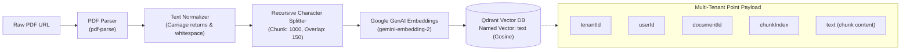
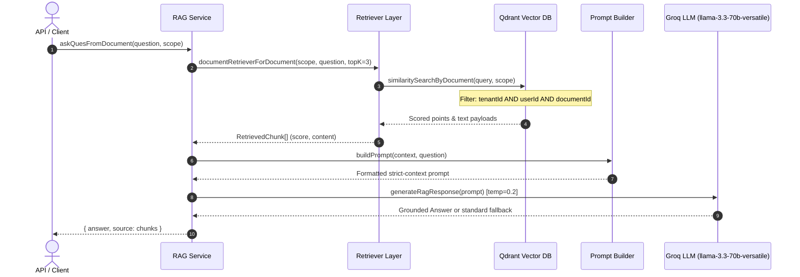
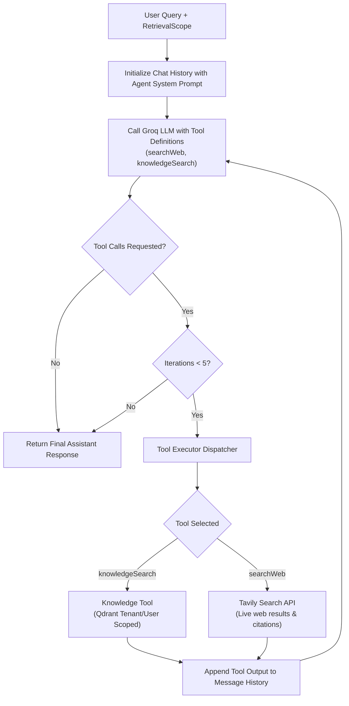

# Axon AI Engine (`packages/ai`) 🧠⚡

The **Axon AI Engine** is a modular, enterprise-grade AI, RAG (Retrieval-Augmented Generation), and autonomous agent package for Axon. It powers semantic document ingestion, multi-tenant vector search, strictly grounded question-answering, and autonomous tool-augmented reasoning across external web sources and private company knowledge bases.

---

## 📑 Table of Contents

- [Overview](#-overview)
- [Key Features & Capabilities](#-key-features--capabilities)
- [System Architecture & Processing Pipelines](#-system-architecture--processing-pipelines)
  - [1. Document Ingestion & Vector Indexing](#1-document-ingestion--vector-indexing)
  - [2. Multi-Tenant Scoped RAG Pipeline](#2-multi-tenant-scoped-rag-pipeline)
  - [3. Autonomous ReAct Tool-Calling Agent Loop](#3-autonomous-react-tool-calling-agent-loop)
- [Module Breakdown & File Structure](#-module-breakdown--file-structure)
  - [Document Processing (`src/document`)](#document-processing-srcdocument)
  - [Embeddings Service (`src/embeddings`)](#embeddings-service-srcembeddings)
  - [Vector Database Layer (`src/vector`)](#vector-database-layer-srcvector)
  - [Types & Security Scope (`src/types`)](#types--security-scope-srctypes)
  - [RAG Core & Context Retrieval (`src/rag`)](#rag-core--context-retrieval-srcrag)
  - [LLM Engine (`src/llm`)](#llm-engine-srcllm)
  - [Tooling System (`src/tools`)](#tooling-system-srctools)
  - [Agent Orchestrator (`src/agent`)](#agent-orchestrator-srcagent)
- [Multi-Tenancy & Access Control](#-multi-tenancy--access-control)
- [Tools & External Integrations](#-tools--external-integrations)
- [Environment Configuration](#-environment-configuration)
- [Developer Usage & Code Examples](#-developer-usage--code-examples)
  - [1. Document Ingestion Pipeline](#1-document-ingestion-pipeline)
  - [2. Grounded RAG Query (Single Document & All Documents)](#2-grounded-rag-query-single-document--all-documents)
  - [3. Autonomous Tool-Calling Agent](#3-autonomous-tool-calling-agent)
- [Verification & Build](#-verification--build)
- [Feature Status Matrix](#-feature-status-matrix)

---

## 🔭 Overview

`packages/ai` operates as an independent domain package that can be imported directly by backend services (such as `apps/api`) or run within background job workers.

It abstracts the complexity of:
- Remote PDF fetching and text extraction with automatic resource cleanup.
- Recursive text chunking and normalization.
- Vector embedding generation using Google Generative AI (`gemini-embedding-2`).
- Multi-tenant vector storage, indexing, and similarity search using Qdrant named vectors.
- Low-temperature, hallucination-resistant RAG queries.
- Tool-calling agent workflows (ReAct pattern) powered by Groq and Llama 3.3.

---

## 🚀 Key Features & Capabilities

1. **Robust Document Ingestion**: Fetches remote PDFs via URL, extracts pure text using `pdf-parse`, and cleans up parser instances safely.
2. **Deterministic Semantic Chunking**: Normalizes line endings, strips redundant whitespace, and applies recursive character splitting (1,000 character chunks with 150 character overlap).
3. **High-Dimensional Embeddings**: Integrates `@langchain/google-genai` to generate 1536-dimensional embeddings with Google Gemini.
4. **Strict Multi-Tenant Vector Isolation**: Every vector point is tagged with `tenantId`, `userId`, `documentId`, and `chunkIndex`. All queries strictly filter by tenant and user to eliminate cross-tenant data leakage.
5. **Named Vector Indexing in Qdrant**: Configures collections with named vector `text` utilizing Cosine distance metrics.
6. **Strictly Grounded RAG (`rag.service.ts`)**: Generates answers strictly from retrieved document chunks with low temperature (`0.2`) and built-in anti-hallucination guardrails.
7. **Autonomous Tool Agent (`agent.service.ts`)**: Implements an iterative ReAct reasoning loop (up to 5 iterations) capable of dynamically executing internal document searches or live external web searches.

---

## 🏛️ System Architecture & Processing Pipelines

### 1. Document Ingestion & Vector Indexing



---

### 2. Multi-Tenant Scoped RAG Pipeline



---

### 3. Autonomous ReAct Tool-Calling Agent Loop



---

## 📁 Module Breakdown & File Structure

```text
packages/ai/
├── src/
│   ├── agent/
│   │   └── agent.service.ts         # High-level entry point for autonomous agent
│   ├── document/
│   │   ├── chunking.ts              # Recursive text splitting & normalization
│   │   └── pdf.parser.ts            # PDF downloading & text extraction
│   ├── embeddings/
│   │   └── embedding.service.ts     # Google Generative AI embeddings generator
│   ├── llm/
│   │   ├── client.ts                # Multi-turn autonomous tool loop client
│   │   └── rag.client.ts            # Low-temperature strictly grounded RAG client
│   ├── rag/
│   │   ├── promptBuilder.ts         # Anti-hallucination prompt construction
│   │   ├── rag.service.ts           # Document-level & user-level RAG workflows
│   │   └── retriever.ts             # Multi-tenant vector similarity retriever
│   ├── tools/
│   │   ├── knowledge.tool.ts        # Internal document retrieval tool wrapper
│   │   ├── tavily.tool.ts           # External real-time search tool via Tavily API
│   │   ├── tool.definitions.ts      # Function call schemas for LLM tools
│   │   └── tool.executor.ts         # Tool routing and dispatcher
│   ├── types/
│   │   └── retrieval.ts             # RetrievalScope and RetrievedChunk interfaces
│   └── vector/
│       ├── qdrant.client.ts         # Qdrant client connection
│       ├── qdrant.collection.ts     # Collection creation & schema definition
│       └── qdrant.service.ts        # Vector upsert & filtered similarity search
├── package.json
├── tsconfig.json
└── Readme.md
```

---

### Document Processing (`src/document`)

- **[`pdf.parser.ts`](file:///c:/Users/NISHANT%20SINGH/OneDrive/Desktop/Axon/packages/ai/src/document/pdf.parser.ts)**:
  - `extractPdfText(pdfUrl: string): Promise<string>`
  - Instantiates `PDFParse({ url: pdfUrl })` to fetch and parse remote PDF documents.
  - Automatically invokes `await parser.destroy()` in a `finally` block to prevent resource leaks.
  - Throws an error if no text can be extracted.

- **[`chunking.ts`](file:///c:/Users/NISHANT%20SINGH/OneDrive/Desktop/Axon/packages/ai/src/document/chunking.ts)**:
  - `splitDocument(text: string): Promise<string[]>`
  - Normalizes line breaks (`\r\n` $\rightarrow$ `\n`) and collapses redundant newlines (`\n{3,}` $\rightarrow$ `\n\n`).
  - Utilizes `@langchain/textsplitters` `RecursiveCharacterTextSplitter`.
  - Configured with:
    - `chunkSize`: **1000** characters
    - `chunkOverlap`: **150** characters
    - `separators`: `["\n\n", "\n", ".", " "]`

---

### Embeddings Service (`src/embeddings`)

- **[`embedding.service.ts`](file:///c:/Users/NISHANT%20SINGH/OneDrive/Desktop/Axon/packages/ai/src/embeddings/embedding.service.ts)**:
  - `getEmbeddings(text: string[]): Promise<number[][]>`
  - Uses `@langchain/google-genai` (`GoogleGenerativeAIEmbeddings`).
  - Reads `GEMINI_API_KEY`, `EMBEDDING_MODEL` (e.g. `gemini-embedding-2`), and `EMBEDDING_DIMENSION` (e.g. `1536`).
  - Performs batch vector embedding generation over arrays of text chunks.

---

### Vector Database Layer (`src/vector`)

- **[`qdrant.client.ts`](file:///c:/Users/NISHANT%20SINGH/OneDrive/Desktop/Axon/packages/ai/src/vector/qdrant.client.ts)**:
  - Initializes the `@qdrant/js-client-rest` client configured with `QDRANT_URL` (default: `http://localhost:6333`).

- **[`qdrant.collection.ts`](file:///c:/Users/NISHANT%20SINGH/OneDrive/Desktop/Axon/packages/ai/src/vector/qdrant.collection.ts)**:
  - `createCollection(): Promise<unknown>`
  - Creates the configured Qdrant collection (`QDRANT_COLLECTION`) using named vectors:
    ```typescript
    vectors: {
      text: {
        size: Number(process.env.EMBEDDING_DIMENSION),
        distance: "Cosine",
      },
    }
    ```

- **[`qdrant.service.ts`](file:///c:/Users/NISHANT%20SINGH/OneDrive/Desktop/Axon/packages/ai/src/vector/qdrant.service.ts)**:
  - `upsertDocument(chunks: string[], scope: RetrievalScope)`:
    - Validates `tenantId`, `userId`, and `documentId`.
    - Generates embeddings for all chunks in batch.
    - Generates point payloads with `id: randomUUID()`, `vector: { text: vector }`, and payload metadata (`tenantId`, `userId`, `documentId`, `chunkIndex`, `text`).
    - Executes upsert with `wait: true`.
  - `similaritySearchByUser(query: string, scope: RetrievalScope, topK: number = 5)`:
    - Embeds the query and performs a similarity search filtered strictly by `tenantId` and `userId`.
  - `similaritySearchByDocument(query: string, scope: RetrievalScope, topK: number = 3)`:
    - Embeds the query and performs a similarity search filtered strictly by `tenantId`, `userId`, and `documentId`.

---

### Types & Security Scope (`src/types`)

- **[`retrieval.ts`](file:///c:/Users/NISHANT%20SINGH/OneDrive/Desktop/Axon/packages/ai/src/types/retrieval.ts)**:
  ```typescript
  export interface RetrievalScope {
      tenantId: string;
      userId: string;
      documentId?: string;
  }

  export interface RetrievedChunk {
      id: string | number;
      score: number;
      content: string;
      documentId: string;
      chunkIndex: number;
  }
  ```

---

### RAG Core & Context Retrieval (`src/rag`)

- **[`retriever.ts`](file:///c:/Users/NISHANT%20SINGH/OneDrive/Desktop/Axon/packages/ai/src/rag/retriever.ts)**:
  - `documentRetrieverForDocument(scope, query, topK = 3)`: Scoped vector retrieval for a specific document.
  - `documentRetrieverForUser(query, scope, topK = 5)`: Cross-document scoped vector retrieval across all documents belonging to a user.
  - Maps Qdrant points into `{ score: number, content: string }`.

- **[`promptBuilder.ts`](file:///c:/Users/NISHANT%20SINGH/OneDrive/Desktop/Axon/packages/ai/src/rag/promptBuilder.ts)**:
  - `buildPrompt(context: string, question: string): string`
  - Enforces strict anti-hallucination system constraints:
    1. Only use context provided.
    2. Do not invent or assume facts.
    3. Return *"This information is not available in the document."* when missing.
    4. Format multiple details with bullet points.

- **[`rag.service.ts`](file:///c:/Users/NISHANT%20SINGH/OneDrive/Desktop/Axon/packages/ai/src/rag/rag.service.ts)**:
  - `askQuesFromDocument(question: string, scope: RetrievalScope): Promise<RagResult>`:
    - Performs document-scoped vector retrieval (top 3 chunks).
    - Assembles prompt and calls the RAG LLM.
    - Returns `{ answer, source: chunks }`.
  - `askQuesFromUserAllDocument(question: string, scope: RetrievalScope): Promise<RagResult>`:
    - Performs user-wide vector retrieval (top 3 chunks across all user documents).
    - Assembles prompt and calls the RAG LLM.
    - Returns `{ answer, source: chunks }`.

---

### LLM Engine (`src/llm`)

- **[`rag.client.ts`](file:///c:/Users/NISHANT%20SINGH/OneDrive/Desktop/Axon/packages/ai/src/llm/rag.client.ts)**:
  - Low-temperature Groq LLM client (`temperature: 0.2`) for factual precision.
  - Model configured via `LLM_MODEL` (defaults to `llama-3.3-70b-versatile`).
  - Strict system prompt commanding zero assumptions beyond provided context.

- **[`client.ts`](file:///c:/Users/NISHANT%20SINGH/OneDrive/Desktop/Axon/packages/ai/src/llm/client.ts)**:
  - Autonomous ReAct Agent engine.
  - Runs an iterative tool loop (up to 5 iterations).
  - Supplies tool schemas to Groq (`tool_choice: "auto"`).
  - Executes tool calls via `toolExecutor`, feeds responses back with `role: "tool"`, and repeats until the model produces a final answer.
  - Enforces source attribution and clear indication when falling back from internal knowledge to external web search.

---

### Tooling System (`src/tools`)

- **[`tool.definitions.ts`](file:///c:/Users/NISHANT%20SINGH/OneDrive/Desktop/Axon/packages/ai/src/tools/tool.definitions.ts)**:
  - Function schemas compliant with Groq / OpenAI function calling standards:
    - `searchWeb`: `{ query: string }`
    - `knowledgeSearch`: `{ query: string }`

- **[`knowledge.tool.ts`](file:///c:/Users/NISHANT%20SINGH/OneDrive/Desktop/Axon/packages/ai/src/tools/knowledge.tool.ts)**:
  - `knowledgeSearchTool(query: string, scope: RetrievalScope)`
  - Automatically branches between single-document search (if `scope.documentId` is provided) and user-wide document search.
  - Returns `{ found: boolean, results: RetrievedChunk[], message?: string }`.

- **[`tavily.tool.ts`](file:///c:/Users/NISHANT%20SINGH/OneDrive/Desktop/Axon/packages/ai/src/tools/tavily.tool.ts)**:
  - `searchWebTool(query: string)`
  - Leverages `@tavily/core` to perform real-time internet searches.
  - Returns top 3 results formatted with `title`, `url`, and `content`.

- **[`tool.executor.ts`](file:///c:/Users/NISHANT%20SINGH/OneDrive/Desktop/Axon/packages/ai/src/tools/tool.executor.ts)**:
  - `toolExecutor(name: string, args: { query: string }, scope: RetrievalScope)`
  - Dispatches execution to `searchWebTool` or `knowledgeSearchTool` based on `name`.

---

### Agent Orchestrator (`src/agent`)

- **[`agent.service.ts`](file:///c:/Users/NISHANT%20SINGH/OneDrive/Desktop/Axon/packages/ai/src/agent/agent.service.ts)**:
  - `askAgent(question: string, scope: RetrievalScope): Promise<string>`
  - Primary high-level API for triggering the autonomous tool-calling agent.
  - Validates input and delegates to `generateResponse(question, scope)`.

---

## 🔒 Multi-Tenancy & Access Control

To guarantee strict tenant isolation and zero data leakage in shared vector storage, every point written to Qdrant contains indexed metadata and every search applies mandatory filter criteria:

```typescript
filter: {
    must: [
        { key: "tenantId", match: { value: scope.tenantId } },
        { key: "userId",   match: { value: scope.userId } },
        ...(scope.documentId ? [{ key: "documentId", match: { value: scope.documentId } }] : [])
    ]
}
```

- **Tenant Isolation**: An organization can never read, search, or access another organization's vectors.
- **User Isolation**: Users only query documents they own within their tenant.
- **Document Scoping**: When `documentId` is supplied, retrieval is strictly confined to chunks of that specific document.

---

## 🛠️ Tools & External Integrations

| Tool / Provider | Implementation | Purpose | When Activated by Agent |
| :--- | :--- | :--- | :--- |
| **`knowledgeSearch`** | Qdrant + Google GenAI | Vector search across indexed PDF chunks. | When the user asks about uploaded documents, internal company policies, or stored files. |
| **`searchWeb`** | Tavily AI API (`@tavily/core`) | Real-time web search with top 3 citations. | For current events, weather, stock prices, external news, or fallback when internal knowledge has no match. |
| **Direct Reasoning** | Groq (`groq-sdk`) | Direct LLM synthesis without tools. | For general knowledge, logical reasoning, summarization, translation, or math. |

---

## ⚙️ Environment Configuration

The package expects the following environment variables (defined in your root `.env`):

| Variable | Description | Example / Default |
| :--- | :--- | :--- |
| `GEMINI_API_KEY` | Google Generative AI API key for embeddings | `AIzaSy...` |
| `EMBEDDING_MODEL` | Gemini embedding model identifier | `gemini-embedding-2` |
| `EMBEDDING_DIMENSION` | Dimension of the vector output | `1536` |
| `QDRANT_URL` | Qdrant vector database URL | `http://localhost:6333` |
| `QDRANT_COLLECTION` | Target collection name in Qdrant | `nexusai_documents` |
| `GROQ_API_KEY` | Groq Cloud API key for ultra-fast LLM inference | `gsk_...` |
| `LLM_MODEL` | Groq LLM model name | `llama-3.3-70b-versatile` |
| `TAVILY_API_KEY` | Tavily API key for web search | `tvly-...` |

---

## 💻 Developer Usage & Code Examples

### 1. Document Ingestion Pipeline

```typescript
import { extractPdfText } from "./document/pdf.parser";
import { splitDocument } from "./document/chunking";
import { upsertDocument } from "./vector/qdrant.service";
import type { RetrievalScope } from "./types/retrieval";

const scope: RetrievalScope = {
  tenantId: "tenant-enterprise-01",
  userId: "user-eng-42",
  documentId: "doc-handbook-2026",
};

// 1. Extract text from remote PDF URL
const text = await extractPdfText("https://example.com/company-handbook.pdf");

// 2. Split into normalized chunks
const chunks = await splitDocument(text);

// 3. Generate embeddings & upsert to Qdrant
await upsertDocument(chunks, scope);
console.log(`Ingested ${chunks.length} chunks for document: ${scope.documentId}`);
```

---

### 2. Grounded RAG Query (Single Document & All Documents)

```typescript
import { askQuesFromDocument, askQuesFromUserAllDocument } from "./rag/rag.service";
import type { RetrievalScope } from "./types/retrieval";

const scope: RetrievalScope = {
  tenantId: "tenant-enterprise-01",
  userId: "user-eng-42",
  documentId: "doc-handbook-2026",
};

// Query a single document
const docResult = await askQuesFromDocument("What is the remote work policy?", scope);
console.log("Answer:", docResult.answer);
console.log("Top Sources:", docResult.source);

// Query across all user documents
const allDocsResult = await askQuesFromUserAllDocument(
  "Summarize all active security compliance requirements across my documents.",
  { tenantId: scope.tenantId, userId: scope.userId }
);
console.log("All Docs Answer:", allDocsResult.answer);
```

---

### 3. Autonomous Tool-Calling Agent

```typescript
import { askAgent } from "./agent/agent.service";
import type { RetrievalScope } from "./types/retrieval";

const scope: RetrievalScope = {
  tenantId: "tenant-enterprise-01",
  userId: "user-eng-42",
  documentId: "doc-handbook-2026",
};

// The agent dynamically chooses knowledgeSearch, searchWeb, or direct response
const response = await askAgent(
  "According to my uploaded document, what is our travel allowance policy? Also, what is today's weather in San Francisco?",
  scope
);

console.log("Agent Response:\n", response);
```

---

## 🧪 Verification & Build

To verify and type-check the package:

```bash
# In packages/ai directory
cd packages/ai

# Run TypeScript compilation check
./node_modules/.bin/tsc --noEmit

# Test single modules with tsx
npx tsx src/agent/agent.service.ts
```

---

## ✅ Feature Status Matrix

| Layer | Component | Status | Implementation Details |
| :--- | :--- | :---: | :--- |
| **Ingestion** | `pdf.parser.ts` | ✅ Done | Fetches remote PDF via URL; automatic parser teardown |
| **Ingestion** | `chunking.ts` | ✅ Done | 1000 char size, 150 overlap, normalized whitespace |
| **Embeddings** | `embedding.service.ts` | ✅ Done | Batch generation using Google Gemini (`gemini-embedding-2`, 1536 dim) |
| **Vector DB** | `qdrant.client.ts` | ✅ Done | Qdrant REST client initialization |
| **Vector DB** | `qdrant.collection.ts` | ✅ Done | Named vector collection setup with Cosine distance metric |
| **Vector DB** | `qdrant.service.ts` | ✅ Done | Tenant- and user-filtered upsert and similarity search |
| **RAG** | `retriever.ts` | ✅ Done | Document-level & user-level vector similarity retrieval |
| **RAG** | `promptBuilder.ts` | ✅ Done | Context-grounded prompt template with hallucination guardrails |
| **RAG** | `rag.client.ts` | ✅ Done | Low-temperature (`0.2`) Groq LLM inference pipeline |
| **RAG** | `rag.service.ts` | ✅ Done | High-level `askQuesFromDocument` and `askQuesFromUserAllDocument` APIs |
| **Agent** | `tool.definitions.ts` | ✅ Done | Schemas for `searchWeb` and `knowledgeSearch` |
| **Agent** | `knowledge.tool.ts` | ✅ Done | Qdrant-backed knowledge search tool with scoped fallback |
| **Agent** | `tavily.tool.ts` | ✅ Done | Live web search tool returning top 3 snippets and citations |
| **Agent** | `tool.executor.ts` | ✅ Done | Tool name router and execution dispatcher |
| **Agent** | `client.ts` | ✅ Done | Autonomous ReAct agent loop (up to 5 iterations) |
| **Agent** | `agent.service.ts` | ✅ Done | Unified `askAgent` high-level service entry point |
